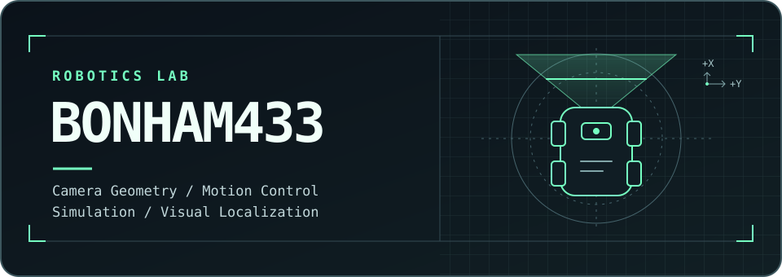

  

我在做移动机器人，主要关注 **运动控制、相机几何和视觉定位**。最近在车上做云台与升降台控制和相机标定，也在 Gazebo 里搭赛道，验证单目定位方案。

## 在做什么

| 方向 | 当前工作 |
| --- | --- |
| **运动控制** | 双轴云台控制 · 升降台舵机控制 · 脉宽与抬升高度标定 |
| **机器人视觉** | 云台相机内外参标定 · 用单目几何估算锥桶相对车体的位置 |
| **定位与仿真** | 用 ROS 2 和 Gazebo 搭建赛道 · 探索单目 VIO 与地图匹配 |

## 开源项目

### [Gazebo World Builder](https://github.com/Bonham433/gazebo-world-builder)

用来搭建 Gazebo 仿真环境的 Agent Skill，覆盖 SDF 场景、URDF 模型、传感器配置和 ROS 2 launch 集成。

  <code>ROS 2</code> &nbsp; <code>Gazebo</code> &nbsp; <code>OpenCV</code> &nbsp; <code>Python</code> &nbsp; <code>Jetson Nano</code> &nbsp; <code>STM32</code>

